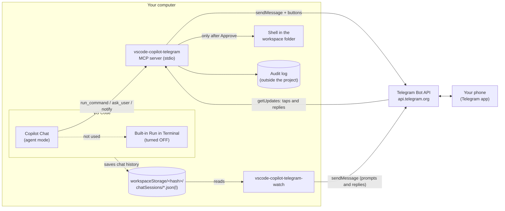

# vscode-copilot-telegram

Follow GitHub Copilot's work in VS Code from Telegram, and approve the shell commands it wants to run from your phone.

vscode-copilot-telegram is two small Python programs (Python 3.11+, Windows / macOS / Linux):

| Program | What it does | How it talks to Telegram |
| --- | --- | --- |
| `vscode-copilot-telegram` (MCP server, started by VS Code) | Gives Copilot agent mode three tools: `run_command` (runs a shell command only after you tap **Approve**), `ask_user` (asks you a question and waits for your answer), and `notify` (one-way status update). | Sends messages, and long-polls `getUpdates` for your taps and replies, but only while something is waiting. |
| `vscode-copilot-telegram-watch` (you start it) | Reads the chat session files VS Code saves for your project (`chatSessions/`) and forwards each of your prompts and each Copilot reply. | Sends only. It never polls, so it can't conflict with the server. |

VS Code doesn't let other programs read or click Copilot's own "Allow?" pop-ups. So you turn off Copilot's built-in **Run in Terminal** tool, and `run_command` becomes the only way Copilot can run a command. If you don't approve a command, it doesn't run.

## How it works



1. Copilot (agent mode) calls `run_command` on the MCP server instead of its built-in terminal.
2. The server checks the block list, the allow list, and that the working folder is inside the workspace, then sends you a Telegram message with **Approve / Deny / Deny with note** buttons.
3. Your tap comes back through `getUpdates`. Only on **Approve** does the server run the command; the exit code and output go back to Copilot and a short tail goes to Telegram.
4. Separately, the watcher reads the chat history VS Code writes to disk and forwards each new message to the same Telegram chat.

Everything is outbound HTTPS to Telegram, so you don't need open ports, a public URL, or a webhook.

## Features

- **Approve commands on your phone.** Each request shows the project, the command, the working folder, and Copilot's reason, with **✅ Approve**, **❌ Deny**, and **📝 Deny with note** buttons. Your note goes back to Copilot.
- **Fail closed.** If you deny, don't answer before the timeout (10 minutes by default), Telegram can't be reached, or the server is misconfigured, the command doesn't run. The one exception: a command that matches your allow list still runs when Telegram can't be reached (the allow list is empty by default).
- **Block list and allow list.** Dangerous commands, like `rm -rf /` or a forced `git push`, are denied without asking. Commands you trust, like `git status`, can be auto-approved, and you still get a notice. You switch that on yourself with `--accept-policy` in your terminal, so an edit to the project file by Copilot can't turn it on. A command that chains other commands (`;`, `&&`, `|`, and similar) is never auto-approved.
- **Only you can answer.** Messages and taps from any other Telegram user are ignored. Each button works once, even after a restart.
- **Secrets masked, everything logged.** Tokens, keys, and passwords are masked before anything is sent to Telegram or written to the audit log (outside the project, in `~/.vscode-copilot-telegram/`), which records every request and decision.
- **Questions and chat mirror.** Copilot can ask you a question with `ask_user` (answer buttons or a typed reply). The watcher sends your prompts and Copilot's replies to the same chat.

The details are in [CONFIGURATION.md](docs/CONFIGURATION.md) (block and allow lists, tools, and every option) and [SECURITY.md](SECURITY.md) (what is and isn't protected).

## Quickstart

You need Python 3.11+, git, VS Code, and GitHub Copilot with agent mode. The full walkthrough for Windows and macOS, with every click, is in **[docs/SETUP.md](docs/SETUP.md)**.

1. **Create a bot.** In Telegram, send `/newbot` to **@BotFather** and copy the token. Send any message to **@userinfobot** to get your numeric id. Then open your new bot and tap **Start**.
2. **Install** (into its own folder, not inside your project):
   ```bash
   git clone https://github.com/weslylaboy/vscode-copilot-telegram.git
   cd vscode-copilot-telegram
   python3 -m venv .venv && source .venv/bin/activate      # Windows: py -3 -m venv .venv; .\.venv\Scripts\Activate.ps1
   pip install -e .
   ```
3. **Save the credentials** in `~/.config/vscode-copilot-telegram/.env` (on Windows, `C:\Users\YOU\.config\vscode-copilot-telegram\.env`):
   ```
   TELEGRAM_BOT_TOKEN=123456789:AA...
   TELEGRAM_USER_ID=123456789
   ```
4. **Test Telegram:** `vscode-copilot-telegram --test --workspace /path/to/your/project`. It prints `sent` and you get a ✅ message.
5. **Register the MCP server** in your project: copy [`examples/dot-mcp.json`](examples/dot-mcp.json) to `<project>/.mcp.json` and set `command` to the full path of `vscode-copilot-telegram` in your venv ([SETUP §8](docs/SETUP.md#8-register-the-mcp-server-in-your-project)). This project supports the Copilot harness (the default agent runtime) only; VS Code has deprecated the Local harness and it is not supported here ([SETUP §7](docs/SETUP.md#7-copilot-harness-and-the-built-in-terminal)).
6. **In Copilot Chat** (agent mode): add the built-in-terminal settings from [SETUP §7](docs/SETUP.md#7-copilot-harness-and-the-built-in-terminal), keep the permission level on **Manual permissions**, and run **Chat: Manage Tool Approval** to pre-approve the vscode-copilot-telegram tools. If your build shows **Configure Tools**, also untick **Run in Terminal** there.
7. **Tell Copilot to use the tools.** Paste [`examples/copilot-instructions.md`](examples/copilot-instructions.md) into `<project>/.github/copilot-instructions.md`.
8. **Start the mirror:** `vscode-copilot-telegram-watch --workspace /path/to/your/project`.
9. **Try it:** ask Copilot to *"use run_command to run `git status`"* and approve the request on your phone.

Then go through the [verification checklist](docs/SETUP.md#12-end-to-end-verification-checklist).

## Documentation

| Doc | Contents |
| --- | --- |
| [docs/SETUP.md](docs/SETUP.md) | Step-by-step setup for Windows (PowerShell) and macOS, keeping the watcher running (Task Scheduler, launchd, systemd), and the verification checklist |
| [docs/CONFIGURATION.md](docs/CONFIGURATION.md) | Every environment variable, `vscode-copilot-telegram.toml` option, and CLI flag, with allow and block list examples |
| [docs/TROUBLESHOOTING.md](docs/TROUBLESHOOTING.md) | Fixes for missing messages, dead buttons, 409 conflicts, missing sessions, the wrong Copilot account, and blocked tunnels |
| [docs/ARCHITECTURE.md](docs/ARCHITECTURE.md) | Module map, request flow, design decisions, the chat session formats, and known limitations |
| [docs/DEVELOPMENT.md](docs/DEVELOPMENT.md) | Running the tests, CI, what hasn't been tested yet, and the roadmap |
| [SECURITY.md](SECURITY.md) | Threat model, where the token lives, and what is and isn't gated |
| [CHANGELOG.md](CHANGELOG.md) | Release notes |

## Important limitations

Know these two before you rely on it: **file edits aren't gated** (Copilot writes files with its own edit tools, so review them with `git diff` and work on a branch), and **the gate only works while Copilot's built-in Run in Terminal is off**. The project also hasn't been tested yet against a live Telegram and a live VS Code; the open items are in [To do](#to-do). Which files in the project can change how the gate works is listed in [SECURITY.md](SECURITY.md#project-files-that-can-change-the-gate).

The full list is in [ARCHITECTURE.md → Known limitations](docs/ARCHITECTURE.md#known-limitations), and [SECURITY.md](SECURITY.md#what-is-and-isnt-gated) shows what is and isn't gated.

## To do

Open work, in three groups. More detail on the tests and the roadmap is in [DEVELOPMENT.md](docs/DEVELOPMENT.md#what-is-not-tested-yet).

### Left to test

The automated tests use a fake Telegram and sample files. These still need a real run:

- [ ] **Real Telegram:** long polling, the `409 Conflict` message, rate limits, how the messages look, the reply prompt for a deny note, and edits on old messages.
- [ ] **Real VS Code and Copilot:** Copilot uses `run_command` when Run in Terminal is off, tool approval works as described, the Copilot harness reads `.mcp.json`, and `${workspaceFolder}` and `envFile` work on each OS.
- [ ] **Real chat session files** from a current VS Code on Windows, macOS, and VS Code Server (tunnels, SSH, WSL). Save small scrubbed samples as test fixtures.
- [ ] **Windows:** `cmd.exe` and PowerShell quoting in `run_command`, killing the whole process tree, and Task Scheduler with `pythonw.exe`.
- [ ] **macOS:** the launchd agent and the privacy prompts.
- [ ] **Linux:** the systemd user service.
- [ ] **`--accept-policy`** typed in a real terminal on Windows and Linux, and in the VS Code terminal (macOS was run by hand once).
- [ ] **VS Code settings and MCP:** the `chat.tools.edits.autoApprove` setting for the files that control the gate, and registering the server in the user-level MCP configuration (outside the project) so a project can't change its `command`. Details in [DEVELOPMENT.md](docs/DEVELOPMENT.md#what-is-not-tested-yet).
- [ ] **The full [verification checklist](docs/SETUP.md#12-end-to-end-verification-checklist)** on each OS.

### Left to do

- [ ] Add a `preToolUse` hook that blocks the built-in terminal, so the gate also holds in Copilot harness sessions. This matters more now that only the Copilot harness is supported ([SETUP §7](docs/SETUP.md#7-copilot-harness-and-the-built-in-terminal)).
- [ ] Approval for file edits (today only shell commands are gated).
- [ ] One poller shared by several VS Code windows, to remove the one-bot-per-window rule.
- [ ] Full paths for the shells on Windows (`powershell`, `pwsh`, `cmd.exe`, `bash`), so a file with that name in the project can't run in place of the real shell. `taskkill` already uses its full path.
- [ ] Publish to PyPI, so the install is `pipx install vscode-copilot-telegram`.
- [ ] Slack and Discord as other ways to approve.

### To improve

Security notes that are missing from the docs:

- [ ] In the troubleshooting guide, use `curl` for `deleteWebhook` so the token doesn't stay in the browser history.


## License

MIT © 2026 Wesly Laboy. See [LICENSE](LICENSE).
