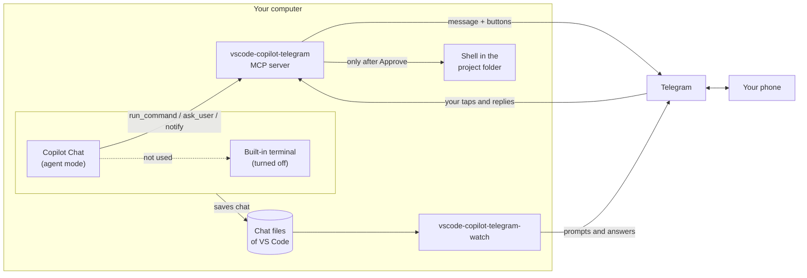

# vscode-copilot-telegram

Follow GitHub Copilot from Telegram, and approve its shell commands from your phone.

It has two small Python programs (Python 3.11 or newer, Windows, macOS and Linux):

| Program | What it does |
| --- | --- |
| `vscode-copilot-telegram` | An MCP server that VS Code starts. It gives Copilot three tools: `run_command`, `ask_user` and `notify`. |
| `vscode-copilot-telegram-watch` | You start it. It reads the chat files of VS Code and sends your prompts and Copilot's answers to Telegram. |

## What you can do

- Approve or deny each command Copilot wants to run. A command does not run until you approve it, in VS Code or on Telegram.
- Answer questions from Copilot (`ask_user`), in VS Code or on Telegram, with buttons or a typed reply.
- Step away from the computer. Copilot asks you in VS Code first. If you do not answer in 3 minutes, the same question goes to Telegram, so you can answer from your phone and Copilot continues.
- Read the Copilot chat in Telegram (the watcher).
- Block dangerous commands (like `rm -rf /` or `git push --force`) without asking.

## How it works

1. Copilot calls `run_command` instead of its built-in terminal.
2. The server checks the command and shows you a form in VS Code: approve or deny, with an optional note.
3. If you do not answer in 3 minutes (`vscode_wait_s`), the same question also goes to Telegram, with three buttons: Approve, Deny, Deny with note. The form in VS Code stays open.
4. The first answer wins. Only on Approve the command runs. Copilot gets the exit code and the output.

`ask_user` works the same way for questions.

Copilot also has a built-in terminal. You cannot switch it off in the Copilot harness, so the instructions file tells Copilot to use `run_command` instead. See [step 7 of SETUP](docs/SETUP.md#7-turn-off-the-built-in-terminal).

Everything is outbound HTTPS to Telegram. You do not need open ports or a public URL.



## Quick start

You need Python 3.11+, git, VS Code with GitHub Copilot (agent mode) and Telegram.

This is a short overview. Every step, with the commands for Windows and macOS, is in [docs/SETUP.md](docs/SETUP.md).

1. Download and install the tool (do this once):

   ```bash
   git clone https://github.com/weslylaboy/vscode-copilot-telegram.git
   cd vscode-copilot-telegram
   python3 -m venv .venv && source .venv/bin/activate    # Windows: py -3 -m venv .venv; .\.venv\Scripts\Activate.ps1
   pip install -e .
   ```

2. Create a Telegram bot with @BotFather, and get your user id from @userinfobot.
3. Save the bot token and your user id in `~/.config/vscode-copilot-telegram/.env`.
4. Test the connection. Use the folder of your own project, the project you want Copilot to work on:

   ```bash
   vscode-copilot-telegram --test --workspace /full/path/of/your/project
   ```

5. In the project you want to get Telegram notification, add the file `.mcp.json` with the server.
6. In VS Code, turn off the built-in terminal of Copilot. Add `.github/copilot-instructions.md` in your project, so Copilot uses `run_command`.

## Limits

Read these two before you use it:

- Only shell commands are gated. Copilot edits files with its own tools, and those do not ask you on Telegram. Work on a git branch and check `git diff`.
- The gate works only while the built-in terminal of Copilot is off.

## Docs

| File | What is inside |
| --- | --- |
| [docs/SETUP.md](docs/SETUP.md) | Install and first approval, step by step |
| [docs/WATCHER.md](docs/WATCHER.md) | The chat mirror, and how to keep it running |
| [docs/CONFIGURATION.md](docs/CONFIGURATION.md) | Variables, TOML file, allow and block lists, flags |
| [docs/TROUBLESHOOTING.md](docs/TROUBLESHOOTING.md) | Common problems and fixes |
| [SECURITY.md](SECURITY.md) | What is protected and what is not |
| [docs/ARCHITECTURE.md](docs/ARCHITECTURE.md) | Modules, request flow, design decisions |
| [docs/DEVELOPMENT.md](docs/DEVELOPMENT.md) | Tests, CI, manual checklist, roadmap |
| [docs/STYLE.md](docs/STYLE.md) | How we write the docs |
| [CHANGELOG.md](CHANGELOG.md) | Release notes |

## License

MIT. See [LICENSE](LICENSE).
