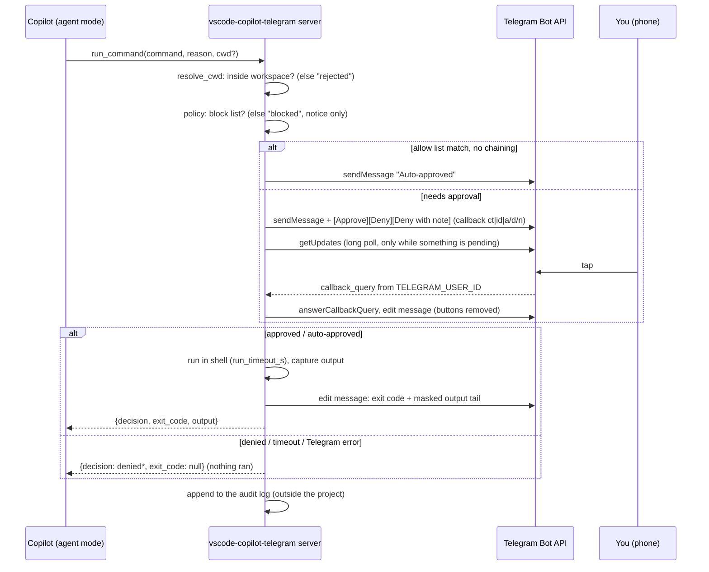

# Architecture

vscode-copilot-telegram is two independent processes that share one Telegram bot and one config loader:

- **`vscode-copilot-telegram`**: an MCP server over stdio, started by VS Code. It owns all two-way traffic with Telegram (send, edit, long-poll).
- **`vscode-copilot-telegram-watch`**: a long-running file watcher you start yourself. It reads VS Code's chat history from disk and only **sends** to Telegram.

Neither listens on a port. Both talk to `https://api.telegram.org` over outbound HTTPS.

## Module map

All code is in `src/vscode_copilot_telegram/`.

| Module | Role | Depends on |
| --- | --- | --- |
| `__init__.py` | Package version (`__version__`, kept in sync with `pyproject.toml`). | — |
| `__main__.py` | `python -m vscode_copilot_telegram` → starts the MCP server. | `server` |
| `server.py` | MCP entry point (`vscode-copilot-telegram` script). Declares the three tools with their schemas and descriptions, parses CLI flags (`--workspace`, `--test`, `--log-level`), wires config → Telegram client → broker → bridge, implements `--test`. Works with the `mcp` SDK 1.x (`FastMCP`) and 2.x (`MCPServer`). | `bridge`, `broker`, `config`, `telegram` |
| `bridge.py` | The tool logic, free of MCP so it can be tested directly. `Bridge.run_command` (jail → policy → ask → run → report), `Bridge.ask_user`, `Bridge.notify`. Builds the Telegram message HTML and the audit records. | `broker`, `policy`, `runner`, `workspace`, `masking`, `audit` |
| `broker.py` | Matches Telegram replies to waiting requests. Request ids, inline keyboards, callback parsing, typed-reply routing, the single poller, `/pending` and `/help`, and persisted answered ids. | `telegram` |
| `telegram.py` | Minimal Bot API clients on `httpx`: `TelegramAPI` (async, used by the server: `sendMessage`, `editMessageText`, `editMessageReplyMarkup`, `answerCallbackQuery`, `getUpdates`) and `TelegramSender` (sync, send-only, used by the watcher, with retries). `split_message` for the 4096-character limit. The token is redacted from error text. | `httpx` |
| `policy.py` | `CommandPolicy`: built-in and user block lists, the allow list, and the shell-chaining check that disables auto-approval. The block list wins over the allow list. | — |
| `runner.py` | Runs an approved command in the chosen shell with a run timeout, kills the whole process tree on timeout, strips `TELEGRAM_BOT_TOKEN` from the child environment, and truncates output. | — |
| `workspace.py` | `resolve_cwd`: resolves `cwd` (after symlinks) and rejects anything outside the workspace root. | — |
| `masking.py` | `mask_secrets`: regexes for PEM keys, GitHub/AWS/Slack/OpenAI/Google/Telegram tokens, bearer/basic auth, credentials in URLs, and `.env`-style `SECRET=…` assignments. | — |
| `audit.py` | `AuditLog`: append-only JSONL with a lock; masks every string field. | `masking` |
| `config.py` | `Settings` dataclass and defaults, `vscode-copilot-telegram.toml` loading and validation, `.env` loading order (never the project's own `.env`), credentials, workspace resolution. Refuses a bot token in the TOML file. Ignores an allow list (or `use_default_block = false`) that you haven't accepted, and implements `--accept-policy` (the accepted copy lives in `~/.config/vscode-copilot-telegram/accepted-policy.json`; it refuses patterns that approve everything and warns about risky ones). The default audit log path is outside the project (`~/.vscode-copilot-telegram/`). | `python-dotenv`, `tomllib` |
| `sessions.py` | Finds VS Code `workspaceStorage/<hash>` folders for a project and parses the three chat formats into `Turn(key, role, text, complete)`. Unknown kinds and missing fields are skipped, never fatal. | — |
| `watcher.py` | Watch loop (`vscode-copilot-telegram-watch` script): polls session files by mtime/size, dedupes by turn key, waits for streaming replies to settle, formats and sends, persists state. | `sessions`, `telegram`, `masking`, `config` |

Tests are in `tests/` (one file per module plus `test_mcp_smoke.py`, which starts the real server over stdio). See [DEVELOPMENT.md](DEVELOPMENT.md).

## Request flow: `run_command`

`ask_user` is the same minus the policy and runner: option buttons use callbacks `ct|<id>|o<N>`, and typed text is routed to the open question (by swipe-reply if several are open). `notify` is a single `sendMessage`.

## Design decisions

### Fail closed

A command runs only after a positive decision. Every other path returns a `denied*`, `blocked`, or `rejected` decision with `exit_code: null`:

- Deny, or Deny with note → `denied`
- No tap before `timeout_s` → `denied-timeout` (a pending "Deny with note" gets a short grace period to finish the note, then is still a deny)
- The approval message can't be sent → `denied-error`
- Bad config or missing token → the server still starts so VS Code shows its tools, but `run_command` returns `denied-error` with the config error (and `ask_user` / `notify` return `error: …`)
- `cwd` outside the workspace → `rejected`; block-list match or empty command → `blocked`

Allow-listed commands are the only exception, and only when they fully match a pattern in an allow list you accepted (`--accept-policy`) and contain no chaining characters. Even then a notice goes to Telegram (if the notice can't be sent, the allow-listed command still runs; that's the one place Telegram isn't required).

### A single poller

Telegram's `getUpdates` allows one consumer per bot; a second gets `409 Conflict`. So:

- Only the MCP server polls, and only while at least one request is pending (`Broker._ensure_poller` starts it, the loop exits when `_pending` is empty).
- The watcher uses `TelegramSender`, which has no `getUpdates` at all, so it can share the bot.
- On the very first poll for a workspace, the broker skips the backlog (`getUpdates(offset=-1)`) so old messages can't answer new requests.
- The update offset is persisted in `.vscode-copilot-telegram/broker-state.json`.
- The 409 case is logged with a pointer to the one-bot-per-window rule.

### Single-use callbacks

- Each request gets `secrets.token_hex(6)` (12 hex chars). Buttons carry `ct|<id>|<action>`, well under Telegram's 64-byte `callback_data` limit, so several requests can be open at once.
- The first valid answer resolves the request and its id goes into `answered` (persisted, last 500). Later taps get *Already answered*; taps on ids the process doesn't know get *This request has expired*.
- Timed-out and cancelled requests are also marked answered, so a late Approve can't run anything.
- After a decision the message is edited and its keyboard removed.
- Updates are accepted only from `TELEGRAM_USER_ID` and only from that chat.

### Masking

`mask_secrets` runs on everything that leaves the machine for Telegram (commands, reasons, questions, answers, output tails, notifications, mirrored chat) and on every string written to the audit log. It errs toward over-masking. The output returned to **Copilot** is not masked, because Copilot already has access to the workspace and needs the real output to work. Masking is best-effort pattern matching, not a guarantee; see [SECURITY.md](../SECURITY.md).

### Two processes, not one

The mirror and the gate have different lifetimes: the MCP server lives and dies with a VS Code window and must start fast; the watcher should survive reloads and keep its own state. Keeping them separate also means the approval path doesn't depend on undocumented chat-file formats.

### Minimal dependencies

`mcp`, `httpx`, and `python-dotenv` only. No Telegram framework: the server needs six Bot API methods, and owning them keeps the polling and offset behaviour explicit.

## Chat session formats (watcher)

See [DEVELOPMENT.md → chatSessions format assumptions](DEVELOPMENT.md#chatsessions-format-assumptions) for the exact fields relied on. In short, `sessions.py` handles:

1. `chatSessions/<id>.json` (older VS Code): one JSON object with `requests[]`, each with `message.text` and `response[]` parts.
2. `chatSessions/<id>.jsonl` (VS Code ≥ 1.109): an append-only operation log (`kind` 0 snapshot, 1 set, 2 push/splice, 3 delete) replayed into the same object.
3. `GitHub.copilot-chat/transcripts/<id>.jsonl` (newer Copilot Chat / Copilot harness): typed events (`user.message`, `assistant.message`, `tool.execution_start`).

If both `<id>.json` and `<id>.jsonl` exist, the `.jsonl` wins. Unknown shapes are skipped, never fatal.

## Known limitations

This is the one full list. Other docs link here.

- **Only `run_command` is gated.** File edits, the built-in Run in Terminal, tasks, notebooks, and other MCP servers or extensions don't go through Telegram. The table of what is and isn't gated, and how to review file edits, is in [SECURITY.md](../SECURITY.md#what-is-and-isnt-gated).
- **The gate requires the built-in terminal to be off.** VS Code offers no API for other extensions or processes to answer Copilot's own confirmations. If Run in Terminal is enabled, those commands bypass Telegram (they still hit VS Code's own prompt unless auto-approved). Run in Terminal can't always be unticked in the Copilot harness; the fallback is in [SETUP §7](SETUP.md#7-copilot-harness-and-the-built-in-terminal).
- **One bot per VS Code window** that runs the server (Telegram allows one poller per bot).
- **Some files inside the project are trusted.** The MCP config (`.mcp.json`) is read by VS Code, not by this tool, and VS Code gives it the same trust as the workspace; Copilot can edit it without approval (the edit-approval setting in [SECURITY.md](../SECURITY.md#accepting-the-allow-list) gives you a click). The other keys of `vscode-copilot-telegram.toml` are trusted too, but they can't make a command run without your tap. An allow list in the TOML is ignored until you accept it with `--accept-policy`, the project `.env` is never read, and the audit log is outside the project. See [SECURITY.md](../SECURITY.md#project-files-that-can-change-the-gate).
- **Model compliance.** Copilot has to choose `run_command`. With the built-in terminal off it has no other way to run commands, but it may give up instead.
- **The watcher reads undocumented files** and is best-effort; format changes can break it without breaking approvals.
- **Telegram message limits.** Long commands are cut to 2500 characters in the message (the full command still runs and is in the audit log); outputs are tail-truncated.
- **Single user.** One `TELEGRAM_USER_ID` per server.
