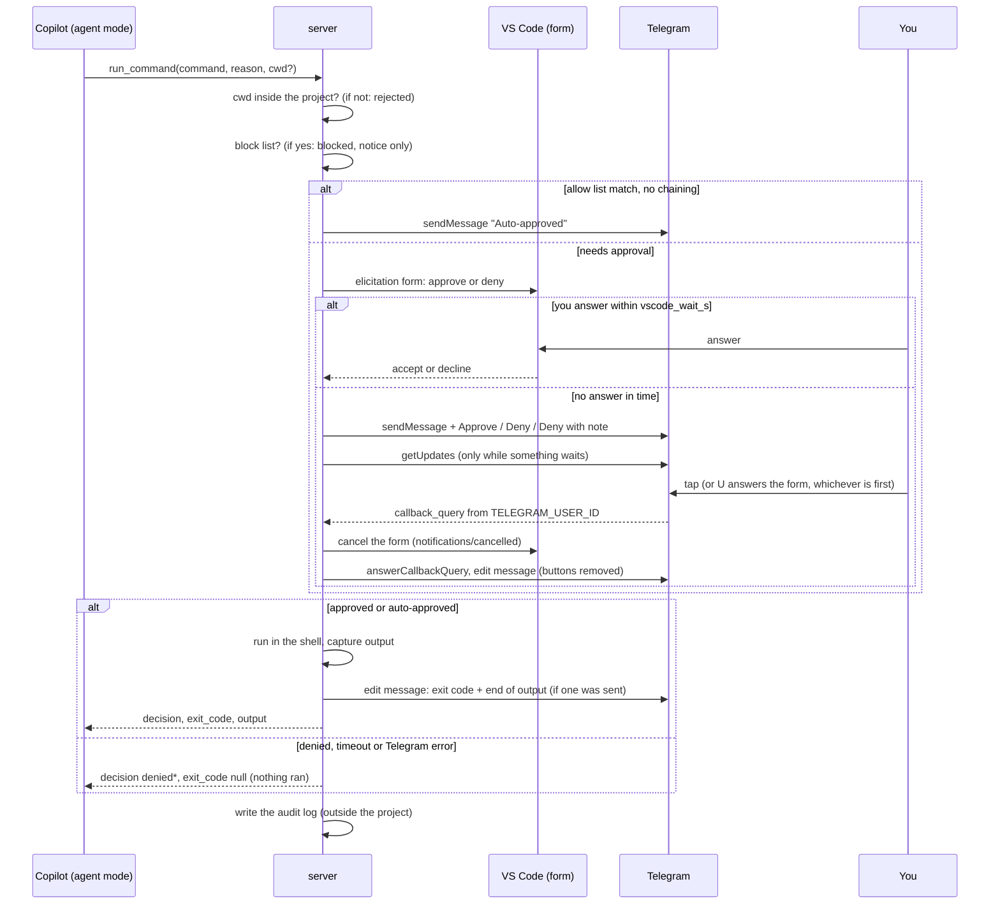

# Architecture

Two separate processes share one Telegram bot and one config loader:

- `vscode-copilot-telegram`: an MCP server over stdio, started by VS Code. It does all the two-way work with Telegram (send, edit, read).
- `vscode-copilot-telegram-watch`: a program you start. It reads the chat files of VS Code and only sends to Telegram.

Neither opens a port. Both use outbound HTTPS to `https://api.telegram.org`.

## Module map

All code is in `src/vscode_copilot_telegram/`.

| Module | Job | Uses |
| --- | --- | --- |
| `__init__.py` | The version (`__version__`). Keep it equal to `pyproject.toml`. | |
| `__main__.py` | `python -m vscode_copilot_telegram` starts the MCP server. | `server` |
| `server.py` | MCP entry point. Declares the three tools, reads the flags (`--workspace`, `--test`, `--accept-policy`, `--log-level`), connects config, Telegram client, broker and bridge. `vscode_prompt` turns a question into an MCP elicitation form in VS Code (the only place that knows about forms). Works with `mcp` 1.x (`FastMCP`) and 2.x (`MCPServer`). | `bridge`, `broker`, `config`, `telegram` |
| `bridge.py` | The logic of the tools, without MCP, so tests can call it. `run_command` (jail, policy, ask, run, report), `ask_user`, `notify`. `_decide` asks in VS Code first (through a `LocalPrompt` that `server.py` passes in) and on Telegram after `vscode_wait_s`. Builds the Telegram messages and the audit records. | `broker`, `policy`, `runner`, `workspace`, `masking`, `audit` |
| `broker.py` | Matches Telegram replies to waiting requests. Request ids, buttons, callback parsing, typed replies, the single poller, `/pending` and `/help`, and the answered ids saved on disk. | `telegram` |
| `telegram.py` | Small Bot API clients on `httpx`. `TelegramAPI` (async, for the server): `sendMessage`, `editMessageText`, `editMessageReplyMarkup`, `answerCallbackQuery`, `getUpdates`. `TelegramSender` (sync, send only, for the watcher, with retries). `split_message` for the 4096-character limit. The token is removed from error texts. | `httpx` |
| `policy.py` | `CommandPolicy`: built-in and user block lists, the allow list, and the chaining check that turns off auto-approval. The block list wins. | |
| `runner.py` | Runs an approved command in the chosen shell with a timeout. Kills the whole process tree on timeout, removes `TELEGRAM_BOT_TOKEN` from the environment, cuts long output. | |
| `workspace.py` | `resolve_cwd`: resolves `cwd` (after symlinks) and rejects anything outside the project. | |
| `masking.py` | `mask_secrets`: patterns for PEM keys, GitHub, AWS, Slack, OpenAI, Google and Telegram tokens, bearer and basic auth, credentials in URLs, and `SECRET=...` lines. | |
| `audit.py` | `AuditLog`: append-only JSONL with a lock. Masks every string field. | `masking` |
| `config.py` | `Settings` and defaults, TOML loading and validation, `.env` load order (never the project `.env`), credentials, project folder. Refuses a token in the TOML. Ignores an allow list (or `use_default_block = false`) that you did not accept. Implements `--accept-policy`. The default audit log is outside the project. | `python-dotenv`, `tomllib` |
| `sessions.py` | Finds the `workspaceStorage/<hash>` folders of a project and parses the three chat formats into `Turn(key, role, text, complete)`. Unknown kinds and missing fields are skipped. | |
| `watcher.py` | The watch loop. Checks session files by time and size, removes duplicates by turn key, waits for streaming replies to settle, formats, sends, saves its state. | `sessions`, `telegram`, `masking`, `config` |

Tests are in `tests/`, one file for each module, plus `test_mcp_smoke.py`. See [DEVELOPMENT.md](DEVELOPMENT.md).

## Flow of `run_command`

`ask_user` is the same without the policy and the runner. Option buttons use the callback `ct|<id>|o<N>`. Typed text goes to the open question (by swipe-reply if several are open). `notify` is one `sendMessage`.

If VS Code cannot show forms (no elicitation, no back-channel, Autopilot), or you dismiss the form, the server skips the wait and asks on Telegram at once. `vscode_wait_s = 0` turns the VS Code step off.

## Design decisions

### Fail closed

A command runs only after a positive decision. Every other path returns `denied*`, `blocked` or `rejected`, with `exit_code: null`:

- Deny, or Deny with note: `denied`.
- No answer before `timeout_s` (it starts when the Telegram message is sent): `denied-timeout`. A pending Deny with note gets a short time to finish the note, and then it is still a deny.
- The approval message cannot be sent and VS Code did not answer: `denied-error`. If Telegram fails but the VS Code form is still open, you can still answer it until `timeout_s` runs out.
- If VS Code and Telegram answer at the same moment with different decisions, the denial wins.
- Bad config or no token: the server still starts, so VS Code shows the tools. `run_command` returns `denied-error` with the error. `ask_user` and `notify` return `error: ...`.
- `cwd` outside the project: `rejected`. Block list match or empty command: `blocked`.

The one exception is a command that fully matches an allow list you accepted and has no chaining characters. It still sends a notice. If the notice cannot be sent, the command still runs. This is the only place where Telegram is not needed.

### One poller

Telegram allows one `getUpdates` reader for each bot. A second one gets `409 Conflict`. So:

- Only the server reads, and only while at least one request waits. `Broker._ensure_poller` starts the loop. It stops when `_pending` is empty.
- The watcher uses `TelegramSender`, which has no `getUpdates`, so it can use the same bot.
- On the first read for a project, the broker skips the old messages (`getUpdates(offset=-1)`), so old messages cannot answer new requests.
- The offset is saved in `.vscode-copilot-telegram/broker-state.json`.
- A 409 is logged with a note about one bot for each window.

### Single-use buttons

- Each request gets `secrets.token_hex(6)` (12 hex characters). The buttons carry `ct|<id>|<action>`. This is far below the 64-byte limit of Telegram, so several requests can be open.
- The first valid answer closes the request and its id goes into `answered` (saved, last 500). A later tap gets Already answered. A tap on an unknown id gets This request has expired.
- Timed-out and cancelled requests are also marked answered, so a late Approve runs nothing.
- After a decision, the message is edited and the buttons are removed.
- Only updates from `TELEGRAM_USER_ID`, in that chat, are accepted.
- If VS Code answers after the Telegram message was sent, the server cancels the Telegram request. Its id is marked answered, so a later tap does nothing, and the message is edited to say it was answered in VS Code.

### The older protocol only (mcp 2.x)

`mcp` 2.x also speaks the 2026-07-28 protocol. In it, a server cannot ask the user while a call is running (`ctx.elicit` fails with "no back-channel"). Copilot's runtime tries that protocol first, with `server/discover`, and falls back to `initialize` only if the server refuses. So `server.py` answers `server/discover` with "method not found" (`_LegacyOnlyRead`, used by `_run_stdio_legacy_only`). The client then uses the `initialize` protocol, where the form works. Without this, every question skips the form and goes to Telegram at once. `mcp` 1.x only speaks the older protocol, so it needs nothing. If this mcp version does not have the pieces, the server starts normally.

### Masking

`mask_secrets` runs on everything that goes to Telegram (commands, reasons, questions, answers, output, notices, mirrored chat) and on every string in the audit log. It prefers to mask too much. The output to Copilot is not masked, because Copilot already has the files and needs the real output. Masking is a best effort. See [SECURITY.md](../SECURITY.md).

### Two processes

The server lives and dies with a VS Code window, and it must start fast. The watcher should survive reloads and keep its own state. Two programs also mean the approval path does not depend on chat file formats that are not documented.

### Few dependencies

Only `mcp`, `httpx` and `python-dotenv`. There is no Telegram framework. The server needs six Bot API methods, and writing them keeps the reading and the offset clear.

## Chat file formats

The watcher reads three formats. The exact fields are in [DEVELOPMENT.md](DEVELOPMENT.md#chat-file-formats).

1. `chatSessions/<id>.json` (older VS Code): one JSON object with `requests[]`.
2. `chatSessions/<id>.jsonl` (VS Code 1.109 and newer): a log of operations that is replayed into the same object.
3. `GitHub.copilot-chat/transcripts/<id>.jsonl` (newer Copilot Chat and Copilot harness): typed events.

If `<id>.json` and `<id>.jsonl` both exist, the `.jsonl` wins. Unknown shapes are skipped.

## Known limitations

This is the only full list. Other docs link here.

- Only `run_command` is gated. File edits, the built-in terminal, tasks, notebooks, and other MCP servers or extensions do not go through Telegram. See [SECURITY.md](../SECURITY.md#what-is-gated).
- The built-in terminal must be off. VS Code has no way for other programs to answer the confirmations of Copilot. If Run in Terminal is on, those commands skip Telegram. In the Copilot harness you often cannot untick it, so use the settings in [SETUP.md](SETUP.md#7-turn-off-the-built-in-terminal).
- One bot for each VS Code window that runs the server.
- Some files in the project are trusted. `.mcp.json` is read by VS Code, and Copilot can edit it without asking. The other keys of the TOML are trusted, but they cannot run a command without your tap. See [SECURITY.md](../SECURITY.md#files-in-the-project-that-can-change-the-gate).
- Copilot must choose `run_command`. With the built-in terminal off it has no other way to run commands, but it can give up.
- The watcher reads files that are not documented. A format change can break it, but it does not break approvals.
- Telegram limits: a long command is cut to 2500 characters in the message (the full command still runs and is in the audit log). Output is cut from the start and the end is kept.
- The VS Code form covers only `run_command` and `ask_user`. VS Code has no way for other programs to answer its own prompts (tool approval, the built-in terminal, file edits, Copilot's own question tool), so those stay in VS Code and are not sent to Telegram.
- Forms need a client that supports MCP elicitation. `mcp` 1.x does not send `notifications/cancelled`, so the form stays open in VS Code after Telegram answered (a late answer is ignored). `mcp` 2.x closes it.
- One user. One `TELEGRAM_USER_ID` for each server.
